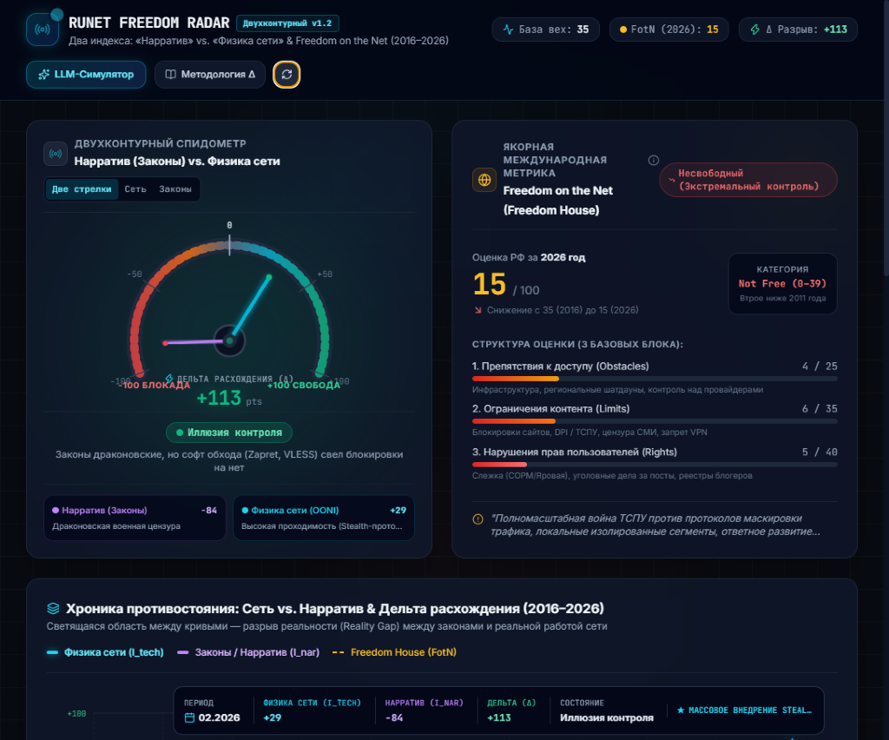

# 📡 Радар Свободы Рунета: Натиск vs. Защита (2016–2026)
### *Runet Freedom Radar: Quantifying the Censorship Reality Gap*

[](https://react.dev/)
[](https://vitejs.dev/)
[](https://tailwindcss.com/)
[](LICENSE)
[](https://pages.github.com/)
[](https://vercel.com/)

Интерактивная аналитическая веб-платформа для мониторинга противостояния государственной цензуры (Роскомнадзор, ТСПУ/DPI) и технологий обхода (VPN, Zapret, ByeDPI, VLESS Reality, AmneziaWG), привязанная к международному эталону **Global Net Freedom Benchmark (GNFB)**.



---

## 💡 В чем фундаментальная идея? (Концепция Reality Gap)

В легальном поле РФ писать об обходе блокировок и рекламировать VPN запрещено законом. Это создает **«ошибку выжившего»**: официальные СМИ обязаны рапортовать о победах цензуры, а успехи технологий обхода замалчиваются.

«Радар Свободы Рунета» разделяет мониторинг на **два параллельных контура**:

1. **🏛 Индекс Нарратива ($I_{\text{nar}}$, от -100 до +100):**
   * Бумажное давление: законы (Яровая, Суверенный Рунет, запрет VPN), судебные решения, реестры РКН, штрафы, дела за посты.
   * Опирается на международный индекс **Global Net Freedom Benchmark (GNFB)**.
2. **⚡ Индекс Физики Сети ($I_{\text{tech}}$, от -100 до +100):**
   * Реальная связность: фактическая проходимость пакетов сквозь ТСПУ (OONI), устойчивость каналов (Cloudflare Radar) и эффективность опенсорсных утилит (Zapret, ByeDPI, Reality, AmneziaWG).
3. **💥 Дельта Расхождения ($\Delta_{\text{gap}} = I_{\text{tech}} - I_{\text{nar}}$):**
   * Числовой показатель разрыва между тем, что регулятор рапортует на бумаге, и тем, как сеть работает на самом деле.

---

## 📊 Матрица состояний Рунета

| Диапазон $\Delta_{\text{gap}}$ | Состояние | Диагноз |
| :---: | :---: | :--- |
| **$\Delta > +60$** | 🟢 **«Иллюзия контроля»** *(Potemkin Control)* | Законы драконовские, но софт свел блокировки на нет. ТСПУ бессилен, YouTube воспроизводится в 4K без внешних серверов. |
| **$+20 < \Delta \le +60$** | 🟡 **«Технологический паритет»** *(Cat & Mouse Race)* | Позиционная война: ТСПУ глушит порты и сигнатуры, сисадмины на лету поднимают stealth-туннели. |
| **$-20 \le \Delta \le +20$** | ⚪ **«Синхронная блокада»** *(Total Compliance)* | Реальность совпала с цензурой: заблокированные сервисы действительно труднодоступны для большинства. |
| **$\Delta < -20$** | 🔴 **«Самострел РКН / Коллапс»** *(Collateral Chaos)* | Реальность хуже риторики: из-за ковровых блокировок или кривых сигнатур ТСПУ падают банки, кассы, домены `.RU` и сайты госорганов. |

---

## 🚀 Быстрый запуск (1-Click Deployment)

### Вариант 1. Развертывание на Vercel (Бесплатно)
1. Сделайте форк этого репозитория на GitHub.
2. Перейдите на [Vercel](https://vercel.com/new) и импортируйте форк.
3. Конфигурация в `vercel.json` подхватится автоматически. Нажмите **Deploy** — через 30 секунд ваш дашборд онлайн.

### Вариант 2. Развертывание на GitHub Pages
В репозитории уже настроен GitHub Action `.github/workflows/deploy.yml`. 
Включите в настройках репозитория: `Settings -> Pages -> Source -> GitHub Actions`. При каждом пуше дашборд будет пересобираться и публиковаться автоматически.

### Вариант 3. Локальный запуск на компьютере
```bash
# 1. Клонировать репозиторий
git clone https://github.com/IvanK-9/runet-freedom-radar.git
cd runet-freedom-radar

# 2. Установить зависимости
npm install

# 3. Запустить локальный сервер
npm run dev
```
Откройте в браузере: `http://localhost:5173/`

---

## 🛠 Архитектура проекта

```
runet-freedom-radar/
├── index.html                   # HTML каркас с кибер-шрифтами Inter & JetBrains Mono
├── package.json                 # React 19, Vite, Tailwind CSS, Lucide Icons
├── vercel.json                  # Конфигурация 1-click деплоя на Vercel
├── .github/workflows/deploy.yml # Авто-сборка и деплой на GitHub Pages
├── docs/                        # Скриншоты и материалы для публикации
│   ├── HABR_ARTICLE.md          # Готовая статья-манифест для публикации на Хабре
│   └── radar_preview.png        # Превью интерфейса
├── public/data/
│   └── events.json              # Открытая база вех (35 событий) для внешних API
├── scripts/
│   └── radar_crawler.py         # Фоновый Python-пайплайн сбора RSS/TG и классификации через LLM
└── src/
    ├── App.jsx                  # Главный контейнер дашборда
    ├── data/
    │   ├── fotnData.js          # Данные Freedom on the Net (2016–2026)
    │   └── historicalEvents.js  # Хроника 35 ключевых вех
    ├── utils/
    │   └── calculator.js        # Двухконтурный расчет: I_nar, I_tech и Δ_gap
    └── components/
        ├── Header.jsx           # Навбар со счетчиками и индикатором Δ
        ├── SpeedometerGauge.jsx # Двухстрелочный спидометр с HUD разрыва
        ├── FotnBadgeCard.jsx    # Карточка Net Freedom Benchmark (3 блока критериев)
        ├── DualTimelineChart.jsx# Двойной график со светящейся областью Reality Gap
        ├── TimeScrubber.jsx     # Ползунок, кнопки эпох и режим Play
        ├── EventFeed.jsx        # Лента событий с фильтрами и поиском
        ├── EventDetailModal.jsx # Детальный технический разбор события
        ├── SimulatorModal.jsx   # LLM-симулятор новостей и «Что если?»
        └── MethodologyModal.jsx # Подробное математическое описание формул
```

---

## 🤝 Как внести вклад (Contributing)

Мы приветствуем Pull Request'ы! Если вы хотите добавить историческую веху или новый сбой цензуры:
1. Откройте файл [`src/data/historicalEvents.js`](src/data/historicalEvents.js) или [`public/data/events.json`](public/data/events.json).
2. Добавьте объект события:
   ```json
   {
     "id": "evt-2026-custom",
     "date": "2026-03-01",
     "year": 2026,
     "title": "Краткое название вехи",
     "category": "rkn_action | bypass_success | rkn_fail",
     "impact_score": 1-10,
     "source_type": "official | media | telegram | tech_community",
     "tech": ["DPI", "ТСПУ", "Zapret", "VLESS"],
     "description": "Техническое описание и последствия",
     "quote_or_source": "Ссылка / подтверждение",
     "fotn_score": 15
   }
   ```
3. Создайте Pull Request — математический движок радара мгновенно пересчитает стрелки спидометра и графики!

---

## 📄 Лицензия

MIT License © 2026 Runet Freedom Radar Contributors. Свободно для исследований, СМИ и некоммерческого использования.
