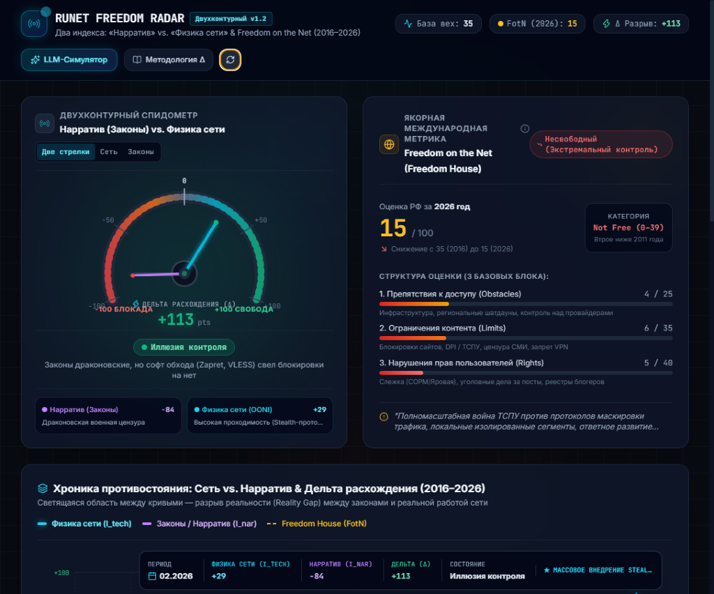

# The Illusion of Control: Quantifying 10 Years of Censorship vs. Circumvention in Russia (2016–2026)

> **TL;DR:** We built and open-sourced **Runet Freedom Radar**, an interactive telemetry dashboard measuring the **Reality Gap** between state regulatory pressure (censorship laws, TSPU/DPI blocklists, fines) and actual network-layer packet survivability (OONI probe tests, Zapret packet desync, VLESS Reality, Tor bridges). Below is the dual-index mathematical formulation, survivorship bias mitigation, and open-source codebase.

* 🌐 **Live Interactive Dashboard:** [ivank-9.github.io/runet-freedom-radar](https://ivank-9.github.io/runet-freedom-radar/)
* 📦 **GitHub Repository:** [github.com/IvanK-9/runet-freedom-radar](https://github.com/IvanK-9/runet-freedom-radar)
* 📊 **Open Dataset (JSON):** [events.json](https://github.com/IvanK-9/runet-freedom-radar/blob/main/public/data/events.json)
* 🛠 **Tech Stack:** React 19, Vite, Tailwind CSS, Lucide Icons, Python (automated news crawler & LLM classifier)



---

## 1. The Core Engineering Dilemma: Survivorship Bias in Censorship Analytics

When developers or data scientists attempt to visualize internet censorship in authoritarian regimes, the naive approach is: *"Let's scrape national news feeds, count government regulator announcements, and plot an outage graph."*

In practice, this approach fails due to **severe survivorship bias**:

1. **The legal media ecosystem is legally sanitized.** In Russia, reporting on circumvention tools, publishing VPN configuration guides, or linking to evasion software is strictly illegal (punishable by fines and extrajudicial website blocking under Roskomnadzor Order No. 168).
2. **Official outlets are mandated to broadcast regulator victories.** State news agencies publish hundreds of articles when a service is throttled or banned. But when a community tool like *Zapret* restores 4K YouTube playback in 30 seconds without a remote server, legal outlets cannot report it.
3. **The Result:** News-only trackers show total digital blackout, while in physical reality, tens of millions of citizens continue accessing the open internet via obfuscated TLS tunnels and local TCP/IP packet manipulation.

To transform our dashboard from an "echo chamber thermometer" into an objective measurement instrument, we split the architecture into **two decoupled analytical streams**.

---

## 2. Dual-Index Architecture: Legal Narrative vs. Network Physics

We established two mutually calibrated indices normalized from **-100** (total blackout / isolation) to **+100** (fully open / unrestricted connectivity):

```
                        [-100 ....................... 0 ....................... +100]
🏛 Narrative Index:     [Total Ban / Legal Gag]      [Parity]                   [Civil Freedom]
⚡ Network Physics:     [Network Blackout / TCP RST] [TSPU Filters 50%]         [100% Connectivity]
```

### 🏛 Index A: Narrative & Legal Pressure ($I_{\text{nar}}$)
Measures administrative, legal, and judicial pressure.
* **Anchor Metric:** Open **Global Net Freedom Benchmark (GNFB)**. Russia's score collapsed from 35/100 in 2016 to 15/100 in 2026 (*Not Free* category).
* **Formula:**
  $$I_{\text{nar}}(t) = -100 \times \left(1 - \frac{\text{FotN}(t)}{100}\right) + \omega_{\text{media}}(t)$$
  where $\omega_{\text{media}}(t)$ is a rolling 90-day operational modifier for emergency legislation and court orders.
* *Behavior:* Monotonically steps downward as new draconian laws are enacted ($-70 \dots -88$).

### ⚡ Index B: Network Physics & Packet Survivability ($I_{\text{tech}}$)
Measures whether IP packets and TLS handshakes actually reach their destination through government TSPU hardware (deep packet inspection).
* **Data Ingestion Sources:**
  1. **OONI Explorer** probe telemetry (ratio of `tcp_reset` and `dns_tampering` anomalies to successful sessions);
  2. **Cloudflare Radar** cross-border telemetry (HTTP/3 traffic volume and session reset ratios);
  3. **GitHub Release Activity** (`bol-van/zapret`, `valdikss/GoodbyeDPI`, `amnezia-vpn`, `XTLS/Xray-core`);
  4. **DownDetector / Sboy.rf** infrastructure crash spikes (measuring collateral damage caused by regulator failures).
* *Behavior:* Oscillatory. When a new ban is deployed, $I_{\text{tech}}$ drops sharply, but rebounds within days as circumvention tools adapt.

---

## 3. The Reality Gap ($\Delta_{\text{gap}}$): Quantifying the "Illusion of Control"

The primary metric of our radar is the differential spread between transport-layer network physics and regulatory paper decrees:

$$\Delta_{\text{gap}} = I_{\text{tech}} - I_{\text{nar}}$$

Because $I_{\text{nar}}$ in Russia stays deeply negative ($-85$), $\Delta_{\text{gap}}$ directly measures societal and technological censorship resistance:

| $\Delta_{\text{gap}}$ Value | State Classification | Physical Network Meaning |
| :---: | :---: | :--- |
| **$\Delta > +60$** | 🟢 **"Illusion of Control"** *(Potemkin Control)* | **Laws are draconian, but software rendered them void.** The regulator declared victory, but open-source patches restored full access for the majority of users. |
| **$+20 < \Delta \le +60$** | 🟡 **"Technological Parity"** *(Cat & Mouse Race)* | **Active positional warfare.** Hardware DPI filters standard WireGuard/OpenVPN handshakes; engineers deploy VLESS Reality. Degradation exists, but the net survives. |
| **$-20 \le \Delta \le +20$** | ⚪ **"Synchronous Blockade"** *(Total Compliance)* | **Physical reality aligns with censorship.** Blocked services are genuinely inaccessible to the general public. |
| **$\Delta < -20$** | 🔴 **"Regulator Self-Harm"** *(Collateral Chaos)* | **Network reality is worse than propaganda.** Misconfigured DPI regexes or BGP null-routes bring down domestic banks, supermarket PoS terminals, and national `.RU` domains. |

---

## 4. 10-Year Historical Calibration (2016–2026)

We calibrated the mathematical model across 35 verified historical milestones:

```
2018: The Battle for Telegram
├── Legal Pressure (I_nar):   -85 (Tagansky court order, FSB encryption key demand)
├── Network Reality (I_tech):  +45 (MTProto proxies deployed, Telegram uptime 99.9%)
└── REALITY GAP (Δ_gap):      +130 [ALL-TIME RECORD "ILLUSION OF CONTROL"]
    (Regulator banned 20 million AWS/Google IPs, taking down banks & supermarkets, but failed to stop Telegram)

2021: Twitter Throttling & the "t.co" Regex Catastrophe
├── Legal Pressure (I_nar):   -40 (Targeted media throttling announced)
├── Network Reality (I_tech):  -75 (kremlin.ru, RT.com, State Duma, and Microsoft went offline)
└── REALITY GAP (Δ_gap):       -35 ["REGULATOR SELF-HARM"]
    (DPI engineers filtered the substring "t.co" without word boundary escaping, matching rt.com and microsoft.com)

2022: Wartime Censorship & The Great VPN Boom
├── Legal Pressure (I_nar):   -95 (Criminal fake-news law, Meta extremism ban, hundreds of media blocked)
├── Network Reality (I_tech):  -20 (VPN downloads surged by 2500%, Russia ranked #2 globally in VPN usage)
└── REALITY GAP (Δ_gap):       +75 [EXPLOSION OF ADAPTATION]

2024: YouTube Throttling & The Triumph of Zapret / ByeDPI
├── Legal Pressure (I_nar):   -80 (Google Video GGC throttling, Discord ban, TLS ECH assault)
├── Network Reality (I_tech):  +30 (Zapret locally splits TCP SYN and TLS ClientHello packets)
└── REALITY GAP (Δ_gap):      +110 [MASSIVE "ILLUSION OF CONTROL"]
    (Hardware DPI blinded by low-TTL fake packets; 4K video streams without third-party servers)
```

---

## 5. UI Architecture & Features

The frontend is built using **React 19 + Vite + Tailwind CSS**:

1. **Dual-Needle Speedometer Gauge:**
   * Features distinct needles: Purple ($I_{\text{nar}}$, 68px) and Neon Cyan/Emerald ($I_{\text{tech}}$, 92px). The length offset guarantees both needles are readable even when overlapping. The central HUD displays the real-time $\Delta_{\text{gap}}$ value and state badge. Needle filter buttons (`Both`, `Network`, `Laws`) allow isolated inspection.
2. **Dual Timeline Chart:**
   * Renders both continuous curves with an illuminated *Reality Gap ribbon* between them, along with the dashed Net Freedom Benchmark curve. Milestone pins are arranged in staggered heights (22px / 36px) to eliminate visual clutter during dense event clusters.
3. **Tactile Time Scrubber with Auto-Playback:**
   * Allows scrubbing month-by-month across 2016–2026, or pressing **"Play Timeline"** to watch a 10-year battle unfold automatically.
4. **LLM Hypothesis Simulator ("What-If? Engine"):**
   * Users can type any hypothetical news headline (or pick presets like *"Regulator tests AI-driven VLESS detection on TSPU"*). The classifier extracts the category, computes impact (1–10), and instantly shifts the needles and timeline right in the browser.

---

## 6. Local Setup & Community Contribution

The codebase is open-source under the MIT License.

```bash
git clone https://github.com/IvanK-9/runet-freedom-radar.git
cd runet-freedom-radar
npm install
npm run dev
```

### How to Contribute Milestones
All historical milestones are stored in [`src/data/historicalEvents.js`](https://github.com/IvanK-9/runet-freedom-radar/blob/main/src/data/historicalEvents.js) and mirrored in [`public/data/events.json`](https://github.com/IvanK-9/runet-freedom-radar/blob/main/public/data/events.json). To add an event, submit a Pull Request with a JSON object:

```json
{
  "id": "evt-2026-vless-filter",
  "date": "2026-03-01",
  "title": "Regulator tests behavioral heuristics against VLESS Reality",
  "category": "rkn_action",
  "impact_score": 8,
  "tech": ["VLESS", "Reality", "ML-filtering", "TSPU"],
  "description": "Technical details and consequences...",
  "quote_or_source": "ntc.party / OONI"
}
```
The calculation engine automatically recomputes exponential decay, recalibrates both needles, and updates the timeline ribbon.

---

## Conclusion

The primary finding of our 10-year empirical model: **the modern internet cannot be shut down by administrative decree without catastrophic collateral damage to domestic digital infrastructure**. Every wave of state restriction accelerates transport-layer protocol evolution: moving from naive web proxies in 2018 to deep packet desynchronization, video-call traffic mimicry, and stealth TLS Reality in 2026.

Stars, issues, and Pull Requests are welcome!

* 🌐 **Live Demo:** [ivank-9.github.io/runet-freedom-radar](https://ivank-9.github.io/runet-freedom-radar/)
* 📦 **GitHub Repository:** [github.com/IvanK-9/runet-freedom-radar](https://github.com/IvanK-9/runet-freedom-radar)
* 💬 **Author on GitHub:** [@IvanK-9](https://github.com/IvanK-9)
