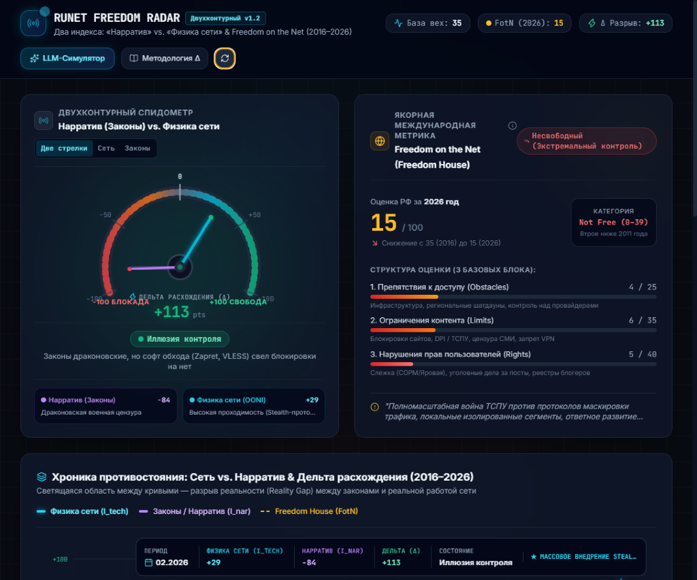

# Иллюзия контроля: как мы оцифровали 10 лет войны Роскомнадзора против протоколов обхода (2016–2026)

> **Кратко для хабровчан:** Мы разработали и выложили в open-source двухконтурный интерактивный дашборд **«Радар Свободы Рунета»**, который рассчитывает разрыв реальности (*Reality Gap*) между бумажным давлением регулятора (законы, реестры, штрафы) и реальной проходимостью пакетов сквозь ТСПУ (DPI, OONI, Zapret, VLESS). Ниже — математика двух индексов, разбор ошибки выжившего и готовый код проекта.

* 🌐 **Живой дашборд:** [ivank-9.github.io/runet-freedom-radar](https://ivank-9.github.io/runet-freedom-radar/)
* 📦 **GitHub репозиторий:** [github.com/IvanK-9/runet-freedom-radar](https://github.com/IvanK-9/runet-freedom-radar)
* 📊 **Открытый датасет (JSON):** [events.json](https://github.com/IvanK-9/runet-freedom-radar/blob/main/public/data/events.json)
* 🛠 **Стек:** React 19, Vite, Tailwind CSS, Lucide, Python (авто-парсер с LLM)



---

## 1. Проблема: почему «просто парсить новости» ломает любую аналитику

Когда программист или аналитик берется визуализировать блокировки в России, первая мысль очевидна: *«Соберем RSS-ленты СМИ, посчитаем упоминания Роскомнадзора и нарисуем график»*. 

Но на практике этот подход натыкается на **классическую ошибку выжившего**:

1. **Легальное медиаполе зачищено.** В РФ законодательно запрещено популяризировать средства обхода блокировок, публиковать инструкции по настройке VPN и рекламировать софт (штрафы и внесудебная блокировка по приказу РКН № 168).
2. **Официальные СМИ обязаны транслировать рапорты регулятора.** О победах РКН (замедлили, заблокировали, оштрафовали) пишут сотни изданий. О том, что утилита Zapret вернула 4K-видео на YouTube за 30 секунд без всякого VPN, легальные медиа писать не имеют права.
3. **Результат:** график, построенный по новостным публикациям, показывает апокалипсис и 100% цифровой концлагерь, тогда как в реальности миллионы людей продолжают пользоваться заблокированными сервисами через обфусцированные туннели и локальные пакетные манипуляторы.

Чтобы радар перестал быть «градусником инфошума» и стал объективным инструментом, нам потребовалось разделить мониторинг на **два параллельных контура**.

---

## 2. Архитектура двух миров: Нарратив vs Физика Сети

Мы ввели два взаимно калибруемых индекса на шкале от **-100** (тотальная изоляция / блокада) до **+100** (свободная связанная сеть):

```
                       [-100 ....................... 0 ....................... +100]
🏛 Индекс Нарратива:   [Тотальный запрет]           [Паритет]                  [Свобода слова]
⚡ Индекс Сети:        [Сетевой блэкаут]            [ТСПУ фильтрует 50%]       [100% связанность]
```

### 🏛 Индекс А: Нарративно-правовой ($I_{\text{nar}}$)
Отражает административное давление государства.
* **Якорная метрика:** международный стандарт прав и доступности **Global Net Freedom Benchmark (GNFB)**. Россия с 2016 по 2026 год рухнула втрое — с 35 до 15 баллов из 100 (категория *Not Free*).
* **Формула:**
  $$I_{\text{nar}}(t) = -100 \times \left(1 - \frac{\text{FotN}(t)}{100}\right) + \omega_{\text{media}}(t)$$
  где $\omega_{\text{media}}$ — оперативная поправка новостного потока законов, штрафов и реестров за 90 дней.
* *Поведение:* Падает ступенчато вниз по мере выхода новых репрессивных законов ($-70 \dots -88$).

### ⚡ Индекс Б: Инженерно-телеметрический ($I_{\text{tech}}$)
Отражает фактическую доступность сервисов и проходимость трафика сквозь государственные комплексы ТСПУ (DPI).
* **Источники данных:** 
  1. Сетевые замеры **OONI Explorer** (соотношение аномалий `tcp_reset` и `dns_tampering` к успешным сессиям);
  2. Трансграничная телеметрия **Cloudflare Radar** (аномалии трафика и доля HTTP/3);
  3. Активность комьюнити на **GitHub** (релизы `bol-van/zapret`, `valdikss/GoodbyeDPI`, `amnezia-vpn`, `XTLS/Xray-core`);
  4. Мониторинг аварийности по **Сбой.рф / DownDetector** (сопутствующий ущерб Рунету).
* *Поведение:* Волнообразное. При новой блокировке проваливается в минус, но по мере распространения контрмер отскакивает обратно вверх.

---

## 3. Дельта Расхождения ($\Delta_{\text{gap}}$): вычисляем «Иллюзию контроля»

Главная метрика нашего проекта — это числовой разрыв между физикой сети и юридическим нарративом:

$$\Delta_{\text{gap}} = I_{\text{tech}} - I_{\text{nar}}$$

Поскольку $I_{\text{nar}}$ в России стабильно находится в глубоком минусе ($-85$), дельта показывает, насколько реальная сеть сопротивляется цензуре:

| Значение $\Delta$ | Состояние | Что это значит в терминах сетей |
| :---: | :---: | :--- |
| **$\Delta > +60$** | 🟢 **«Иллюзия контроля»** | **Законы драконовские, но софт свел их на нет.** РКН отчитался об успехе, но сообщество выпустило патч, и у 80% пользователей все летает. |
| **$+20 < \Delta \le +60$** | 🟡 **«Технологический паритет»** | **Позиционная война «щита и меча».** ТСПУ блокирует сигнатуры WireGuard/OpenVPN, инженеры разворачивают VLESS Reality. Потери есть, но сеть жива. |
| **$-20 \le \Delta \le +20$** | ⚪ **«Синхронная блокада»** | **Реальность совпала с цензурой.** Сервисы действительно труднодоступны для подавляющего большинства населения. |
| **$\Delta < -20$** | 🔴 **«Самострел РКН / Коллапс»** | **Реальность хуже риторики.** Из-за кривых сигнатур ТСПУ падают банки, кассы, домены `.RU` и сайты госорганов. |

---

## 4. Историческая ретроспектива: 10 лет противостояния

Мы откалибровали математическую модель на 35 ключевых исторических вехах за 2016–2026 годы:

```
2018: Битва за Telegram
├── Индекс законов (I_nar):  -85 (Решение суда, требование ключей ФСБ)
├── Индекс сети (I_tech):    +45 (MTProto прокси, Telegram работает без сбоев)
└── РАСХОЖДЕНИЕ (Δ_gap):    +130 [АБСОЛЮТНЫЙ РЕКОРД «ИЛЛЮЗИИ КОНТРОЛЯ»]
    (РКН заблокировал 20 млн IP Amazon и Google, уронил кассы «Дикси» и банки, но Telegram не победил)

2021: Замедление Twitter и факап с "t.co"
├── Индекс законов (I_nar):  -40 (Заявлено выборочное замедление одной платформы)
├── Индекс сети (I_tech):    -75 (Легли kremlin.ru, RT.com, сайт Госдумы и Microsoft)
└── РАСХОЖДЕНИЕ (Δ_gap):     -35 [«САМОСТРЕЛ РКН»]
    (Инженеры применили regex по подстроке без экранирования границ слов)

2022: Военная цензура и VPN-бум
├── Индекс законов (I_nar):  -95 (Закон о фейках, блокировка Meta, запрет сотен СМИ)
├── Индекс сети (I_tech):    -20 (Спрос на VPN взлетел на 2500%, страна освоила обход)
└── РАСХОЖДЕНИЕ (Δ_gap):     +75 [ВСПЛЕСК ТЕХНОЛОГИЧЕСКОЙ АДАПТАЦИИ]

2024: Замедление YouTube и триумф утилит Zapret / ByeDPI
├── Индекс законов (I_nar):  -80 (Троттлинг GGC, блокировка Discord и Signal, атака на ECH)
├── Индекс сети (I_tech):    +30 (Zapret локально фрагментирует TCP SYN/TLS ClientHello)
└── РАСХОЖДЕНИЕ (Δ_gap):    +110 [МОЩНЕЙШАЯ «ИЛЛЮЗИЯ КОНТРОЛЯ»]
    (DPI ТСПУ ослеплен фейковыми пакетами с низким TTL, 4K-видео играет без VPN)
```

---

## 5. Как устроен интерактивный дашборд

Мы собрали фронтенд на **React 19 + Vite + Tailwind CSS**:

1. **Двухстрелочный спидометр:** 
   * Фиолетовая стрелка ($I_{\text{nar}}$) и неоновая циан-стрелка ($I_{\text{tech}}$) в реальном времени показывают баланс сил. Стрелки имеют разную длину (92px vs 68px), чтобы не перекрывать друг друга при близких значениях. В центре — светящийся бейдж дельты с описанием состояния. Есть тумблер для изоляции конкретной стрелки (`Две стрелки` / `Сеть` / `Законы`).
2. **Двухконтурный график:** 
   * Две параллельные кривые с заливкой зоны *Reality Gap* между ними (градиентное свечение от бирюзового к пурпурному) + пунктирная кривая бенчмарка прав (GNFB). Пины событий распределены по шахматной высоте (22px / 36px), исключая наслоение меток.
3. **Таймскруббер с режимом Play:**
   * Можно нажать кнопку **«Запустить таймлайн»**, откинуться на спинку кресла и наблюдать, как стрелки спидометра мечутся на протяжении 10-летней битвы.
4. **LLM-симулятор гипотез («Что если?»):**
   * В модальном окне можно ввести произвольный заголовок новости (или выбрать пресет, например: *«РКН тестирует ИИ-детектирование VLESS Reality на ТСПУ»*).
   * Симулятор классифицирует событие, определяет его силу (Impact 1–10) и мгновенно пересчитывает физическую и нарративную стрелки прямо в браузере.

---

## 6. Как запустить у себя или законтрибьютить

Код полностью открыт под лицензией MIT.

```bash
git clone https://github.com/IvanK-9/runet-freedom-radar.git
cd runet-freedom-radar
npm install
npm run dev
```

### Как добавить событие?
Все вехи вынесены в открытый файл [`src/data/historicalEvents.js`](https://github.com/IvanK-9/runet-freedom-radar/blob/main/src/data/historicalEvents.js) и сдублированы в [`public/data/events.json`](https://github.com/IvanK-9/runet-freedom-radar/blob/main/public/data/events.json). Чтобы добавить событие, достаточно прислать PR с объектом:
```json
{
  "id": "evt-2026-vless-filter",
  "date": "2026-03-01",
  "title": "РКН внедрил поведенческий анализ для блокировки VLESS Reality",
  "category": "rkn_action",
  "impact_score": 8,
  "tech": ["VLESS", "Reality", "ML-фильтрация", "ТСПУ"],
  "description": "Техническое описание инцидента...",
  "quote_or_source": "ntc.party / OONI"
}
```
Движок автоматически пересчитает экспоненциальное затухание, обновит стрелки спидометра и перестроит график.

---

## Заключение

Главный вывод нашего 10-летнего исследования: **интернет в России невозможно отключить административным приказом без катастрофического разрушения собственной экономики**. Каждый виток давления РКН лишь ускоряет эволюцию протоколов: от примитивных прокси Рунет перешел к DPI-десинхронизации, маскировке под видеозвонки и TLS Reality.

Будем рады вашим звездам на GitHub, замечаниям по математической модели и Pull Request'ам с новыми вехами!

* 🌐 **Live Demo:** [ivank-9.github.io/runet-freedom-radar](https://ivank-9.github.io/runet-freedom-radar/)
* 📦 **GitHub Repository:** [github.com/IvanK-9/runet-freedom-radar](https://github.com/IvanK-9/runet-freedom-radar)
* 💬 **Автор на GitHub:** [@IvanK-9](https://github.com/IvanK-9)
